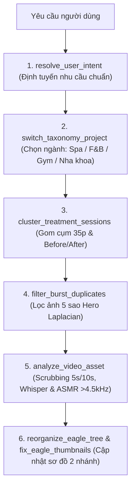

# HƯỚNG DẪN KẾT NỐI VÀ VẬN HÀNH MCP DÀNH CHO ANTIGRAVITY AGENT

> [!IMPORTANT]
> **Đây là tệp chỉ dẫn tự động dành cho Antigravity (Anti). Khi mở thư mục dự án này, Agent hãy đọc ngay các quy tắc dưới đây để kết nối và điều phối toàn bộ 45 MCP Tools.**

---

## 1. Thông Tin Cổng Kết Nối MCP Gateway (MCP Server)

* **MCP Endpoint (HTTP Streamable Transport):** `http://127.0.0.1:8898/mcp`
* **Kiểm tra trạng thái (Health Check):** `http://127.0.0.1:8898/health`
* **Giao diện Web Dashboard trực quan:** `http://127.0.0.1:8899/`
* **Cấu hình Client sẵn sàng:** Đã có tệp `mcp_config.json` và `.mcp.json` tại thư mục gốc.

### Khởi Động Máy Chủ (Nếu Chưa Chạy):
Nếu kiểm tra cổng 8898 chưa hoạt động, Agent chạy lệnh:
```bash
python http_service.py
```
*(Chạy nền 1 tiến trình duy nhất quản lý đồng thời cả cổng MCP 8898 và Dashboard 8899)*.

---

## 2. Quy Trình Vận Hành 6 Bước Chuẩn (Standard Workflow)

Khi nhận bất kỳ yêu cầu nào từ người dùng liên quan đến phân loại, lọc ảnh, video clip, gom ca khách hàng hoặc đồng bộ Eagle DAM, Agent hãy thực thi tuần tự:



### Chi Tiết Từng Bước:
1. **Bước 1 - Định tuyến nhu cầu:** Gọi `resolve_user_intent(user_query=...)` để lấy kế hoạch công cụ tối ưu và các ràng buộc kỹ thuật.
2. **Bước 2 - Ngữ cảnh ngành nghề:** Gọi `switch_taxonomy_project(project_id=...)` (mặc định: `khaihoan_skincare`, các ngành khác: `fb_culinary`, `fitness_gym`, `nha_khoa_clinic`).
3. **Bước 3 - Gom cụm phiên thời gian:** Gọi `cluster_treatment_sessions(max_gap_minutes=35)`. Thuật toán chạy trong 0.05s, 0% RAM, tự động nhóm ca điều trị và phân chia Before/In-Process/After.
4. **Bước 4 - Lọc ảnh 5 sao Hero:** Gọi `filter_burst_duplicates` để chấm điểm nét Laplacian trên các chuỗi ảnh chụp liên tục mà không tốn token AI.
5. **Bước 5 - Phân tích clip dọc 9:16:** Đối với video, gọi `analyze_video_asset(video_path=...)` để tua nhanh 5s/10s bóc keyframes, bóc phụ đề tiếng Việt bằng Faster-Whisper và đo dải tần ASMR dụng cụ >4.5kHz.
6. **Bước 6 - Đồng bộ & Chuẩn hóa:** Gọi `reorganize_eagle_tree` và `fix_eagle_thumbnails` để đảm bảo 100% ảnh hiển thị sắc nét, không lỗi crossed-out eye.

---

## 3. Các Nguyên Tắc Bất Biến (Architectural Invariants)

> [!CAUTION]
> **Tuyệt đối tuân thủ 3 nguyên tắc sau:**
> 1. **Sơ đồ cây 2 nhánh rạch ròi 100%:**
>    * `📸 1. KHO HÌNH ẢNH (Photo Studio)`: Chứa 100% ảnh tĩnh. Không để video lọt vào.
>    * `🎬 2. KHO VIDEO CLIPS (Video Reels & TikTok)`: Chứa 100% video footage dọc 9:16.
> 2. **Hợp đồng tên file vật lý (Deterministic File Contract):**
>    * Tên file trên đĩa cứng phải khớp chính xác 100% với `metadata.json["name"] + "." + metadata.json["ext"]`.
>    * Toàn bộ ký tự cấm Windows/macOS `[:*?"<>|/\\]` bắt buộc phải được lọc sạch.
> 3. **Tối ưu hiệu năng tối đa (Zero-RAM Overhead):**
>    * Tuyệt đối không tải các mô hình deep learning nặng nề (như local CLIP hay optical flow) gây treo máy Mac/PC của nhân viên.
>    * Sử dụng thuật toán thời gian và phổ tần số toán học đã tối ưu hóa sẵn trong kho.

---

## 4. Tài Nguyên MCP (Resources) & Chỉ Lệnh (Prompts) Có Sẵn

* **MCP Resources (Agent có thể đọc trực tiếp):**
  * `resource://skills/universal-media-classifier`: Toàn văn cẩm nang kỹ năng `SKILL.md`.
  * `resource://taxonomy/active`: Cấu hình ngành nghề kinh doanh đang hoạt động.
  * `resource://eagle/tree-structure`: Đặc tả cấu trúc thư viện Eagle DAM.
  * `resource://skills/registry`: Danh mục tất cả các skill có trong hệ thống.
* **MCP Prompts:**
  * `media_classification_workflow`: Mẫu chỉ dẫn phân loại đa ngành.
  * `treatment_session_clustering`: Mẫu chỉ dẫn gom cụm phiên 35 phút.
  * `video_hook_asmr_scrubbing`: Mẫu chỉ dẫn phân tích Hook 3s & ASMR.
