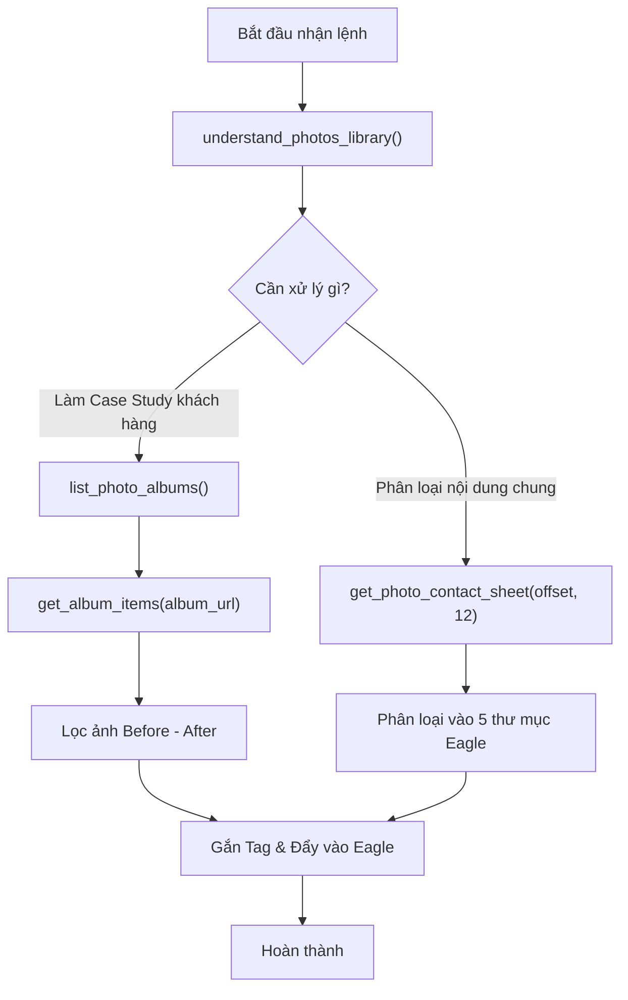

# HƯỚNG DẪN MCP TOOL CHO AGENT: QUÉT ALBUM, ĐỌC ẢNH & HIỂU KHO PHOTOS
**Dành cho hệ thống AI Agent Antigravity & Spa Khải Hoàn Skincare**

---

## 1. Giới thiệu tổng quan
Hệ thống cung cấp một **MCP Server** chuẩn (`gphotos-content-vision`) kết nối trực tiếp với tài khoản Google Photos (`khaihoansk86@gmail.com`) và phần mềm quản lý tư liệu Eagle DAM.

Server MCP chạy tại endpoint: `http://127.0.0.1:8898/mcp` (đã được cấu hình trong `mcp_config.json` và đăng ký trong thư mục `~/.gemini/antigravity/mcp/gphotos-content-vision`).

---

## 2. Các công cụ MCP cốt lõi

### 1️⃣ `understand_photos_library(profile_id)`
* **Công dụng:** Đọc và hiểu toàn cảnh kho Photos trong 1 lần gọi duy nhất.
* **Kết quả trả về:**
  * Tổng số lượng tư liệu: 1.136 file (629 ảnh, 507 video).
  * Tỷ lệ khung hình: **83.5% là ảnh/video dọc (9:16)** chuẩn TikTok/Reels/Shorts.
  * Thống kê 98 Album khách hàng, top 10 khách hàng VIP có nhiều ảnh nhất.
  * Phân tích mức độ sẵn sàng cho từng nhóm nội dung marketing (Liệu trình, Cận cảnh da, Feedback, Cơ sở vật chất).

### 2️⃣ `list_photo_albums(profile_id, refresh=false)`
* **Công dụng:** Quét và liệt kê danh sách toàn bộ 98 Album khách hàng trên Google Photos.
* **Đặc tính:** Lưu cache vào SQLite nội bộ. Gọi lần đầu mất ~7s quét trực tiếp qua Chrome CDP, các lần sau phản hồi tức thì trong 0.01s.
* **Dữ liệu mỗi album:** Tên khách hàng (kèm SĐT nếu có), link Google Photos, số lượng ảnh trong album, ảnh bìa.

### 3️⃣ `get_album_items(profile_id, album_url, max_items=100)`
* **Công dụng:** Đi sâu vào xem toàn bộ ảnh/video thuộc về 1 khách hàng cụ thể.
* **Ứng dụng:** Trích xuất phác đồ điều trị của 1 khách hàng từ ngày đầu đến ngày kết thúc để làm bài viết/video Before-After dạng Case Study.

### 4️⃣ `get_photo_contact_sheet(profile_id, offset, limit=12)`
* **Công dụng:** Đọc và gom **12 ảnh thu nhỏ vào 1 tấm ảnh duy nhất (Contact Sheet)** có đánh số thứ tự từ 1 đến 12.
* **Lợi ích:** Tiết kiệm hơn **92% token thị giác** của AI Model khi cần phân loại hoặc kiểm tra chất lượng ảnh hàng loạt.

### 5️⃣ `get_photo_preview(profile_id, item_id)`
* **Công dụng:** Mở chi tiết 1 ảnh duy nhất khi Agent cần soi kỹ tình trạng nền da, nốt mụn hoặc máy móc thiết bị.

---

## 3. Kịch bản thực thi mẫu của Agent

---

## 4. Bảng phân loại chuẩn Marketing cho Spa

1. **`01_Liệu trình chăm sóc da (Spa)`**: Quy trình chuẩn y khoa, bác sĩ/chuyên viên thực hiện trên mặt khách hàng.
2. **`05_Ảnh cận cảnh làn da (Before-After)`**: Ảnh chụp zoom cận cảnh nền da, soi da dưới đèn spa.
3. **`03_Feedback & Khách hàng trải nghiệm`**: Khách hàng nằm thư giãn, nụ cười hài lòng, phỏng vấn trải nghiệm.
4. **`02_Cơ sở vật chất & Đội ngũ Spa`**: Máy móc thẩm mỹ công nghệ cao, không gian phòng điều trị Khải Hoàn Skincare.
5. **`04_B-Roll Video cận cảnh (Reels/TikTok)`**: Video ngắn dọc 9:16 dùng để cắt ghép B-Roll trên CapCut.
