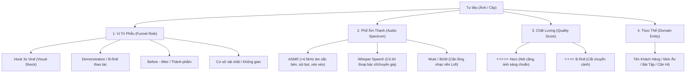
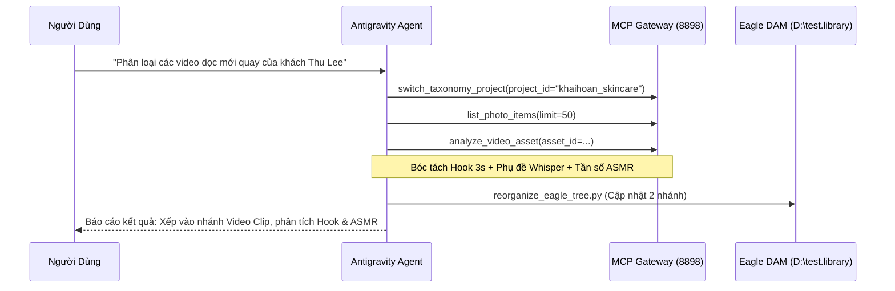

# Quy Trình Phân Loại & Xử Lý Tư Liệu Đa Phương Thức Qua MCP Gateway (Universal Media Classifier)

Kỹ năng này hướng dẫn Antigravity Agent tự động đóng vai trò là **Chuyên Gia Quản Trị Dữ Liệu Đa Phương Thức (Media Intelligence & DAM Coordinator Agent)**: tự động kiểm tra, xem nhanh, phân tích thị giác, bóc tách âm thanh và phân loại hàng ngàn hình ảnh, video clip dọc vào thư viện **Eagle DAM** hoàn toàn thông qua **MCP Endpoint** mà không cần con người phải thao tác thủ công trên giao diện web.

---

## 1. Nguyên Tắc Bất Biến Về Kiến Trúc (Core Invariants)

> [!IMPORTANT]
> Mọi thao tác phân loại của Agent bắt buộc phải tuân thủ nghiêm ngặt 3 nguyên tắc nền tảng sau:

### 1.1. Sơ Đồ Cây 2 Nhánh Rạch Ròi 100% (Strict 2-Branch Tree)
Toàn bộ kho tư liệu tại Eagle DAM (`D:\test.library`) chỉ có **đúng 2 thư mục cha ở cấp gốc**:
* 📸 **1. KHO HÌNH ẢNH (Photo Studio)**: Chứa 100% ảnh tĩnh. Tuyệt đối không để video clip lọt vào nhánh này.
  * ⭐ `1.1 Ảnh 5 Sao Hero (Quảng Cáo & Bìa Bài Viết)`
  * 🔄 `1.2 Cặp Ảnh Trước & Sau (Before - After)`
  * 💆‍♀️ `1.3 Thao Tác KTV & Bác Sĩ (Quy Trình Chuẩn Y Khoa)`
  * 🏥 `1.4 Cơ Sở Vật Chất & Máy Công Nghệ Cao`
  * 👥 `1.5 Hồ Sơ Khách Hàng (Case Studies Theo Ca)` (Chứa các thư mục con theo tên ca điều trị)
* 🎬 **2. KHO VIDEO CLIPS (Video Reels & TikTok)**: Chứa 100% video footage dọc 9:16.
  * 🔥 `2.1 Video Hook 3s Viral (Giữ Chân Người Xem)`
  * 🗣️ `2.2 Video Có Lời Thoại (Đã Bóc Phụ Đề Whisper AI)`
  * 🎧 `2.3 Video Âm Thanh ASMR (Dụng Cụ Spa >4.5kHz)`
  * 💆‍♀️ `2.4 Video B-Roll Thao Tác KTV (Cận Cảnh Liệu Trình)`
  * 🔇 `2.5 Video Câm (Footage Cần Lồng Nhạc BGM)`
  * 👥 `2.6 Video Theo Khách Hàng (Reels Khách Hàng)`

> [!CAUTION]
> Tuyệt đối không tạo ra các thư mục cha trôi nổi, folder nha khoa cũ hoặc các folder rác làm vỡ sơ đồ cây của thư viện.

### 1.2. Hợp Đồng Tên File Vật Lý (Deterministic File Contract)
Eagle DAM hiển thị ảnh dựa trên quy tắc: **Tên file trên ổ cứng phải khớp chính xác 100% với trường `name` trong `metadata.json`**.
* Tên file đĩa: `clean_label.jpg`
* Trong `metadata.json`: `"name": "clean_label"`, `"ext": "jpg"`
* Lọc sạch toàn bộ ký tự cấm của Windows/macOS: `re.sub(r'[:*?"<>|/\\]', '', name)`.
* Nếu vi phạm, Eagle sẽ hiển thị **biểu tượng mắt gạch chéo (broken thumbnail)**.

### 1.3. Hệ Thống Dữ Liệu Đôi (Dual-Facing Metadata)
* **Cho Người Dựng (Content Creator đọc trong Annotation):** Trình bày bằng Markdown rõ ràng:
  * `⏱️ TIMELINE & PHÂN ĐOẠN (Tua nhanh 5s - 10s)`
  * `🎧 PHÂN TÍCH ÂM THANH & LỜI THOẠI`
  * `🎬 GỢI Ý DỰNG CAPCUT / TIKTOK` (Góc text an toàn 120px, nhịp cắt)
  * `🔗 Link gốc Google Photos`
* **Cho AI Agent (Máy đọc qua Tag tiền tố):**
  * Nhân vật/Thực thể: `Khách_<ID>`
  * Định dạng: `Video_Dọc_9:16`, `Ảnh_Ngang_16:9`
  * Công năng phễu: `Hook_3s_Viral`, `B-Roll_Liệu_Trình`, `Before_After`
  * Âm thanh: `ASMR_Spa`, `Phu_De_Whisper`, `Video_Không_Tiếng`
  * Xếp hạng: `Chất_Lượng_5_Sao_Hero`

---

## 2. Mô Hình Phân Loại 4 Chiều Đa Ngành (Universal 4D Taxonomy)

Khi người dùng chuyển sang ngành nghề khác (Nha khoa, F&B, Gym, Bất động sản...), Agent không thay đổi code mà chiếu tư liệu vào **4 Chiều Bất Biến**:



---

## 3. Danh Mục MCP Tools Đang Hoạt Động (Cổng 8898)

Agent giao tiếp trực tiếp qua MCP Server `gphotos-content-vision` tại `http://127.0.0.1:8898/mcp` với các công cụ chủ lực:

| Tên MCP Tool | Công Năng Chính Của Agent |
| :--- | :--- |
| `list_taxonomy_projects` | Tra cứu danh sách các dự án ngành nghề (Spa, F&B, Gym, Nha khoa). |
| `switch_taxonomy_project` | Chuyển đổi ngữ cảnh ngành nghề và tự động kích hoạt bộ nhận diện tương ứng. |
| `get_photo_inventory` | Kiểm tra tiến độ quét và số lượng tư liệu đã nạp từ Google Photos. |
| `list_photo_items` | Lấy danh sách ID, URL ảnh gốc, loại file (photo/video), duration từ kho. |
| `get_photo_contact_sheet` | Đọc 12 ảnh đại diện cùng lúc trên 1 ma trận cuộn phim (Filmstrip) không tốn token. |
| `filter_burst_duplicates` | Chấm điểm Laplacian lọc ảnh nét nhất (5 sao Hero) trong các chuỗi ảnh chụp liên tục. |
| `cluster_treatment_sessions` | Gom cụm chuỗi tư liệu theo cửa sổ thời gian 35 phút (0.05s, 0% RAM): tự động nhóm ca điều trị, lan truyền danh tính khách hàng (Anchor) và xác định Before - In-Process - After. |
| `analyze_video_asset` | Phân tích sâu video: tua nhanh 5s/10s, bóc phụ đề Faster-Whisper, đo tần số ASMR. |
| `enrich_and_sync_eagle` | Rót toàn bộ thông tin trí tuệ marketing, Hook 3s và tag vào Eagle DAM. |
| `commit_to_eagle` | Nhập các tư liệu đã duyệt vào thư viện Eagle chỉ định. |
| `resolve_user_intent` | **Bộ định tuyến nhu cầu & đề xuất tool chuẩn:** Phân tích câu lệnh người dùng, tự động xác định ngành, chọn skill và sinh chuỗi công cụ thực thi tối ưu. |
| `get_skill_guide` | **Đọc tài liệu kỹ năng:** Truy xuất toàn bộ hướng dẫn, quy tắc bất biến và mẫu CapCut của skill qua MCP. |
| `list_available_skills` | Liệt kê danh mục toàn bộ các kỹ năng đã đăng ký trong hệ thống cùng mô tả và tham số. |
| `register_skill` | **Ghi nhận kỹ năng mới:** Cho phép AI hoặc lập trình viên đăng ký động file `SKILL.md` mới vào hệ thống tức thì. |
| `register_taxonomy_project` | **Mở rộng ngành nghề mới:** Đăng ký thêm ngành kinh doanh mới (Bất động sản, Auto Detailing...) với Content Pillars và từ khóa tùy biến. |

### 3.1. Hệ Thống Tài Nguyên Động (MCP Resources) & Mẫu Chỉ Lệnh (MCP Prompts)

Cổng MCP Gateway mở sẵn các kênh dữ liệu trực tiếp chuẩn giao thức MCP:
* **MCP Resources (`resources/list` & `resources/read`):**
  * `resource://skills/universal-media-classifier`: Toàn văn hướng dẫn kỹ năng (SKILL.md).
  * `resource://taxonomy/active`: Cấu hình Content Pillars và từ khóa của ngành nghề đang kích hoạt.
  * `resource://eagle/tree-structure`: Bản đặc tả cấu trúc 2 nhánh rạch ròi của Eagle DAM.
  * `resource://skills/registry`: Danh mục tổng thể tất cả các skill có trong kho.
* **MCP Prompts (`prompts/list` & `prompts/get`):**
  * `media_classification_workflow`: Mẫu chỉ dẫn chuẩn 6 bước cho AI Agent phân loại ảnh/video.
  * `treatment_session_clustering`: Mẫu chỉ dẫn gom cụm phiên thời gian 35 phút.
  * `video_hook_asmr_scrubbing`: Mẫu chỉ dẫn tua nhanh 5s/10s bóc Hook 3s & ASMR >4.5kHz.

---

## 4. Quy Trình Vận Hành Chuẩn 6 Bước Của Agent



### Bước 1: Định Tuyến Nhu Cầu & Xác Định Ngành Nghề (Intent & Domain Routing)
Khi nhận câu lệnh từ người dùng, Agent gọi công cụ định tuyến nhu cầu trước tiên:
```python
# Gọi qua MCP Tool: resolve_user_intent(user_query="Câu lệnh người dùng")
# Hệ thống tự động phân tích intent, trả về:
# - Ngành nghề đích (Target Domain: 'khaihoan_skincare', 'fb_culinary', 'fitness_gym', 'nha_khoa_clinic'...)
# - Kỹ năng khuyến nghị (Recommended Skill)
# - Chuỗi công cụ thực thi chuẩn tuần tự (Tool Execution Plan)
# - Các nguyên tắc bất biến cần kiểm soát (Invariants)
```
Nếu ngành nghề thay đổi, gọi `switch_taxonomy_project(project_id=...)` để kích hoạt bộ nhận diện tương ứng.

### Bước 2: Gom Cụm Phiên Thời Gian (Temporal Session Clustering)
* Gọi `cluster_treatment_sessions(max_gap_minutes=35)`:
  * Nhóm các ảnh/video được chụp liên tục trong vòng 35 phút vào cùng một phiên dịch vụ/ca điều trị (xử lý ~3.000 tư liệu trong 0.05s, 0% RAM).
  * Lan truyền danh tính khách hàng (Anchor Customer ID): Nếu trong cụm có 1 tư liệu mang tên hoặc nhãn khách hàng, toàn bộ các file còn lại trong cụm tự động nhận diện theo khách hàng đó mà không cần mô hình AI khuôn mặt nặng nề.
  * Tự động chia tiến trình hành trình: 25% tư liệu đầu cụm được gán `Giai_Đoạn_Trước_Điều_Trị` (Before), phần giữa là `Giai_Đoạn_Đang_Điều_Trị` (In-Process), 25% cuối là `Giai_Đoạn_Sau_Kết_Quả` (After).

### Bước 3: Xem Nhanh Tư Liệu (Filmstrip Scrubbing 5s - 10s)
* Đối với ảnh chùm (Burst): Gọi `filter_burst_duplicates` để thuật toán đo độ biến thiên Laplacian tính độ sắc nét, tự động gán nhãn `⭐ 1.1 Ảnh 5 Sao Hero` cho ảnh nét nhất và gom các ảnh mờ hơn thành tư liệu phụ.
* Đối với video: Không tải video nặng. Gọi `analyze_video_asset` để trích xuất 8 - 12 keyframes nhảy cóc (`00:01`, `00:03`, `00:08`, `00:15`...) ghép thành Contact Sheet tóm tắt toàn bộ diễn biến clip trong 1 giây.

### Bước 4: Phân Tích Âm Thanh & Bóc Phụ Đề
1. **Kiểm tra lời thoại (Speech):** Nếu có bác sĩ/KTV nói tiếng Việt, Faster-Whisper tự động bóc phụ đề từng giây và gán tag `Phu_De_Whisper`, xếp vào thư mục `🗣️ 2.2 Video Có Lời Thoại`.
2. **Kiểm tra âm thanh dụng cụ (ASMR):** Phân tích phổ tần số. Nếu năng lượng tập trung ở dải tần cao **>4.5kHz** (tiếng nhíp gắp cồi mụn, tiếng xèo xèo chiên nướng, tiếng kim loại va chạm), gán tag `ASMR_Spa`, xếp vào thư mục `🎧 2.3 Video Âm Thanh ASMR`.
3. **Kiểm tra video câm:** Nếu không có âm thanh hoặc tạp âm môi trường, gán tag `Video_Không_Tiếng`, xếp vào thư mục `🔇 2.5 Video Câm (Cần Lồng Nhạc BGM)`.

### Bước 5: Soạn Thảo Annotation Chỉ Dẫn CapCut Cho Editor
Tạo phần mô tả chuẩn chỉ để người dựng clip mở Eagle là làm được ngay:
```markdown
🎬 VIDEO FOOTAGE DỌC 9:16 (TIKTOK / REELS / SHORTS):
• Khách hàng: Thu Lee - 0967033270
• Phân loại: Hook 3s Viral (Cận cảnh nặn mụn)
• Định dạng: Chuẩn Dọc 9:16 (Vùng an toàn 120px dưới đáy tránh icon TikTok che)
• Thể loại âm thanh: 🎧 ASMR (>4.8kHz - Kích volume 130%)
----------------------------------------
⏱️ TIMELINE PHÂN ĐOẠN (TUA NHANH 5s - 10s):
• [00:00 - 00:03] 🔥 HOOK 3S VIRAL: Cận cảnh gắp cồi mụn viêm, da sáng bóng.
• [00:03 - 00:10] 💆‍♀️ THAO TÁC KTV: Kỹ thuật viên đeo găng vô trùng sát khuẩn kỹ.
• [00:10 - 00:20] 🌿 ĐIỀU TRỊ CHUYÊN SÂU: Chiếu đèn sinh học đẩy tinh chất phục hồi.
• [00:20 - HẾT]  ⭐ KẾT QUẢ & NỤ CƯỜI: Làn da dịu đỏ, khách soi gương hài lòng.
----------------------------------------
🎬 GỢI Ý DỰNG CAPCUT:
• Cắt nhanh 1.5s ở đoạn đầu để bắt trend giữ chân người xem.
• Đặt tiêu đề ở giữa khung hình (y: 35% - 65%) tránh các nút tương tác che khuất.
• Link gốc xem lại trên Google Photos: [URL]
```

### Bước 6: Đồng Bộ Hóa & Khắc Phục Lỗi File
Chạy đồng bộ vào Eagle DAM:
* Đảm bảo tên file vật lý và trường `"name"` trong `metadata.json` khớp nhau từng ký tự.
* Cập nhật file cache `%APPDATA%\Eagle\library-caches\5d59398c.txt`.
* Gọi `reorganize_eagle_tree.py` nếu cần làm sạch lại toàn bộ cây thư mục.

---

## 5. Kịch Bản Xử Lý Nhanh Cho Agent

### Tình huống 1: Người dùng nói "Phân loại vào Eagle tôi xem thử"
1. Gọi `switch_taxonomy_project` để đảm bảo đúng ngữ cảnh dự án đang chạy.
2. Chạy `reorganize_eagle_tree.py` để quét toàn bộ kho, chia rạch ròi 2 nhánh Kho Ảnh và Kho Video.
3. Báo cáo bằng bảng thống kê số lượng ảnh Hero, Before-After, Video Hook 3s, Video ASMR và danh sách hồ sơ khách hàng.

### Tình huống 2: Người dùng hỏi "Sao bị mất hết hình / hiện mắt gạch chéo"
1. Nhận biết ngay: Đây là lỗi lệch giữa tên file trên đĩa và trường `name` trong `metadata.json`.
2. Chạy script `fix_eagle_thumbnails.py`.
3. Kiểm tra đối chiếu số lượng `matches / total`.
4. Báo người dùng bật lại ứng dụng Eagle để tải lại ảnh hoàn chỉnh.

### Tình huống 3: Người dùng yêu cầu chuyển sang ngành khác (ví dụ: Nhà Hàng F&B hoặc Gym)
1. Gọi `switch_taxonomy_project(project_id="fb_culinary")` hoặc `"fitness_gym"`.
2. Áp dụng ngay bộ tiêu chí:
   * Hook 3s chuyển thành: Lửa bùng chảo, kéo phô mai, hoặc nâng tạ nặng mồ hôi rơi.
   * ASMR chuyển thành: Tiếng xèo xèo chiên nướng hoặc tiếng tạ dập sàn.
3. Đồng bộ sơ đồ cây của ngành mới vào Eagle DAM.
